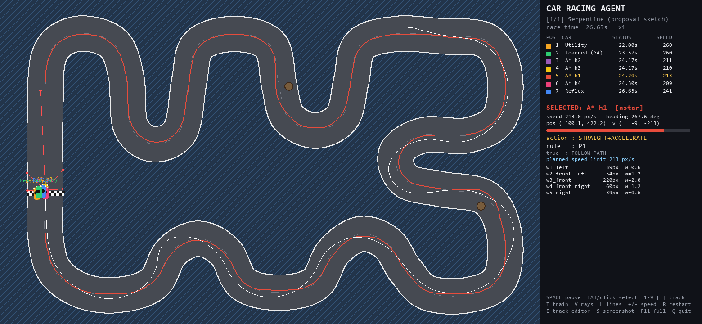
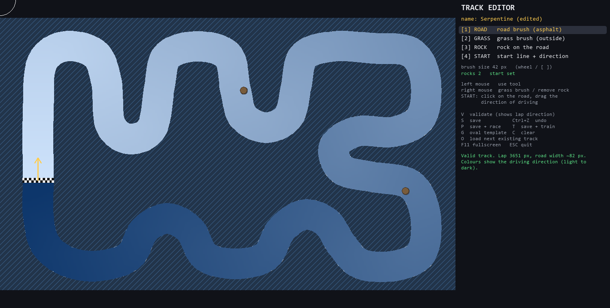

# Car Racing Agent (CSE518 AI Project, Part 1)

Several AI cars race a lap on a winding 2-D track, from the start line to the finish line. Every car senses
the track with **five distance rays (w1–w5)** and chooses **LEFT / STRAIGHT / RIGHT** steering plus
**ACCELERATE / COAST / BRAKE** throttle 30 times a second. Different kinds of AI race each other
(*"Can I make a better AI than AI?"*):

| car | AI type | how it drives |
|---|---|---|
| **A\* h1–h4** | deliberative (search) + reflex safety | A\* plans the whole lap on an occupancy grid; pure-pursuit follows it; safety rules override |
| **Utility** | model-based utility agent | simulates all 9 actions ahead; maximises U = progress + speed − collision risk (weighted sensors) |
| **Reflex** | simple reflex agent | propositional rules over the sensor readings, no map or plan |
| **Learned (GA)** | learning agent | neural network evolved by a genetic algorithm, by running many cars repeatedly |

This follows the approved proposal (`my-idea.jpeg`): agent = car, environment = race track,
state = position/direction/speed/sensor distances, actions = left/right/straight/accelerate/brake,
goal = finish line, search = A\*, sensors = weighted rays, utility = progress vs collision vs speed,
rules = safety/follow path, learning = repeated runs, propositional logic = rules and constraints.



## Deliverables

| # | What | Where |
|---|------|-------|
| 1 | Code: reflex module + A\* path planning (+ utility and learning agents, GUI) | [`racing/`](racing/), [`main.py`](main.py), tests in [`tests/`](tests/) |
| 2 | Comparison of the 4 A\* heuristics (+ agent comparison) | [`notebooks/heuristic_comparison.ipynb`](notebooks/heuristic_comparison.ipynb) |
| 3 | ~2-page progress report | [`report/progress_report.pdf`](report/progress_report.pdf) |
| ★ | Full report on all deliverables (9 pages) | [`report/final_report.pdf`](report/final_report.pdf) (rebuild: `python report/build_full_report.py`) |
| + | Demo videos: race on two tracks + live learning | [`demo/`](demo/) (`race_serpentine.mp4`, `race_technical.mp4`, `learning_serpentine.mp4`) |

## Quick start

```bash
pip install -r requirements.txt

python main.py gui                       # watch the race
python main.py gui --mode train          # watch a population of cars learn to drive (genetic algorithm)
python main.py editor                    # paint your own track, then race / train on it
python main.py race                      # headless race on all tracks, results table
python main.py compare                   # A* heuristic comparison for full-lap planning
python main.py train --generations 100   # re-train the learning agent -> models/ga_best.json
python main.py record --out demo/race.mp4  # .gif also works

python -m pytest -q                      # test suite
python notebooks/build_notebook.py       # rebuild + run Deliverable 2 (writes report/figures/)
python report/build_report.py            # rebuild Deliverable 3 from those results
```

The window opens **maximised** and is drawn at the screen's own resolution (DPI-aware, nothing is stretched),
so it stays sharp on big or high-DPI screens. Resize it freely, or press `F11` for fullscreen.

**GUI keys**: `SPACE` pause · `TAB`/click select car · `1`–`9` or `[` `]` switch track (painted tracks included) ·
`T` race ↔ training mode · `V` rays on all cars · `L` racing lines · `+`/`-` sim speed · `R` restart ·
`E` open this track in the editor · `S` screenshot · `F11` fullscreen · `Q` quit.

## Track editor



`python main.py editor` (or `E` in the race view). Paint the road and the outside area with a round brush:

| key | tool |
|---|---|
| `1` | **ROAD** brush: paint asphalt |
| `2` | **GRASS** brush: paint the outside area / walls (right mouse also does this) |
| `3` | **ROCK**: click to drop a rock on the road, right-click to remove it |
| `4` | **START**: click on the road and drag in the driving direction |
| wheel / `[` `]` | brush size |
| `V` | validate: checks the road is a closed loop that a car fits through, and colours the lap direction |
| `S` / `P` / `T` | save (asks for a name) / save + race / save + train |
| `G` · `C` · `O` · `Ctrl+Z` | oval template · clear · load the next existing track · undo |

A painted track is saved as `tracks/<name>.png` (white = road) plus `tracks/<name>.track`
(`MASK`, `START x y heading`, `OBSTACLES`). A painted track has no centre-line, so lap progress and the finish
line are computed **geodesically**: a Dijkstra run from the start line gives every road pixel its driving
distance. All agents, A\* and the genetic algorithm work on painted tracks without any changes.

## How it works

* **Track** ([`racing/track.py`](racing/track.py)): a `.track` file gives either the centre-line points and
  width (built-in tracks) or a painted mask image (editor tracks), plus any rocks. A closed Catmull-Rom spline is rasterised with scipy distance transforms into a drivable mask,
  the wall clearance per pixel, and the lap position per pixel (for progress and the finish line).
* **Car** ([`racing/car.py`](racing/car.py)): kinematic physics (acceleration 170, brake 420, drag, top speed 260 px/s,
  steering grip that depends on speed), collision with walls, and five vectorised ray sensors.
* **Rules** ([`racing/logic.py`](racing/logic.py), [`racing/agents.py`](racing/agents.py)): percepts become propositions
  (`FrontBlocked`, `LeftMoreOpen`, `TooFast`, …). Rules such as `FrontBlocked ∧ ¬Slow → turn to open side + BRAKE`
  fire in priority order.
* **A\*** ([`racing/planner.py`](racing/planner.py)): 8 px cells, 8-connected, wall-penalty costs (always ≥ length),
  and a barrier across the start line so the plan is a full lap. The heuristics are:

  | id | heuristic | admissible |
  |---|---|---|
  | h0 | Dijkstra (baseline) | yes |
  | h1 | Euclidean | yes |
  | h2 | Manhattan | **no** (8-connected grid) |
  | h3 | Octile | yes |
  | h4 | ALT landmarks (8, farthest-point) | yes |

* **Learning** ([`racing/learning.py`](racing/learning.py)): 7-10-2 tanh network, population 60, elitism +
  tournament selection + uniform crossover + Gaussian mutation. Each generation, every driver races the training tracks from
  the start line and from a random grid slot. It is trained on *serpentine* and *technical*, and *oval* is held out.

Cars are "ghosts" (time-trial style): they race on the same track at the same time but cannot hit each
other, only walls and rocks. A car that touches a wall is out.

## Layout

```
main.py                CLI (gui | race | train | compare | record)
racing/track.py        track files -> mask, clearance, lap progress
racing/car.py          physics, collisions, 5 ray sensors (vectorised)
racing/logic.py        propositional rule engine
racing/planner.py      occupancy grid, A*, heuristics h0-h4, racing line
racing/agents.py       Reflex, PathAgent (A*), Utility, Neuro agents
racing/race.py         multi-car race simulation, standings
racing/learning.py     genetic algorithm (population simulated in parallel)
racing/gui.py          pygame race / training viewer + video recorder
racing/editor.py       track editor (paint road, grass, rocks, start)
racing/view.py         sharp DPI-aware rendering shared by the GUI and the editor
racing/experiments.py  experiment helpers used by the notebook
tracks/*.track         serpentine (proposal sketch), technical, oval
models/ga_best.json    trained learning agent
tests/                 pytest suite
notebooks/             Deliverable 2 (+ builder script)
report/                Deliverable 3 (+ builder script, figures/)
demo/                  MP4 videos and screenshots
old_auv_version/       earlier version built on the default (AUV) problem, not used
```
