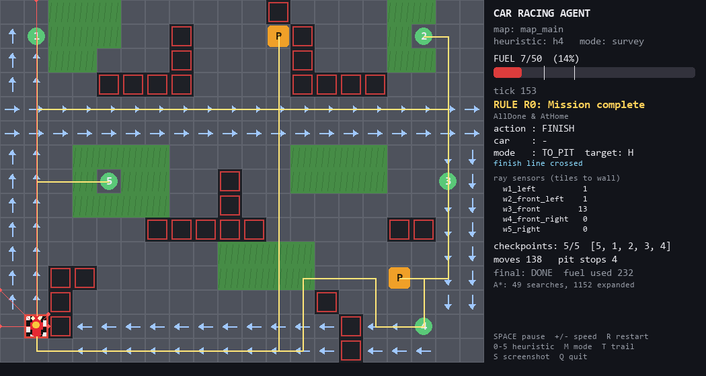

# Car Racing Agent (CSE518 AI Project, Part 1)

A racing car that drives a grid track from the start/finish line **H** through every checkpoint
**1–9** and back to **H**, while managing its fuel. It combines a **reflex module** (prioritized
propositional rules for fuel safety) with a **deliberative path-planning module** (A* with 4 heuristics, plus
an exact Held-Karp tour planner).

This is the course's *Autonomous Underwater Survey Vehicle* problem with a racing theme:

| Problem statement (AUV) | This project (car) | char |
|---|---|---|
| open water (cost 2) | asphalt | `.` |
| kelp (cost 6) | grass / gravel | `~` |
| reef (impassable) | wall | `#` |
| home base | start/finish + garage | `H` (alias `S`) |
| charging dock | pit stop | `C` (alias `P`) |
| survey sites | checkpoints | `1`–`9` |
| battery | fuel | `BATTERY` (alias `FUEL`) |
| ocean current | slope / tailwind lane | `^ > v <` |

The parser reads the course format exactly, so `maps/map_main.txt` and any other course map work unchanged.



## Deliverables

| # | What | Where |
|---|------|-------|
| 1 | Code: reflex module + A* path planning + 4 heuristics | [`src/`](src/), [`main.py`](main.py), tests in [`tests/`](tests/) |
| 2 | Heuristic comparison notebook | [`notebooks/heuristic_comparison.ipynb`](notebooks/heuristic_comparison.ipynb) |
| 3 | ~2-page progress report | [`report/progress_report.pdf`](report/progress_report.pdf) |
| + | Demo recordings | [`demo/`](demo/) (GIFs + step log CSV) |

## Quick start

```bash
pip install -r requirements.txt

python main.py run     --map maps/map_main.txt --heuristic h4 --mode survey   # headless + summary
python main.py run     --map maps/map_main.txt --trace                         # every tick: rule, action, fuel
python main.py gui     --map maps/map_main.txt                                 # animated pygame viewer
python main.py record  --map maps/track_main.txt --mode race --out demo/track.gif
python main.py compare --map maps/map_main.txt                                 # heuristic table
python main.py plan    --map maps/map_main.txt                                 # planned tour only

python -m pytest -q                        # 136 tests
python notebooks/build_notebook.py         # rebuild + execute Deliverable 2 (writes report/figures/)
python report/build_report.py              # rebuild Deliverable 3 PDF from those figures
```

The GUI keys are SPACE pause, `+`/`-` speed, `0`–`5` switch heuristic, `M` survey/race, `T` trail, `S` screenshot, `Q` quit.

## How it works

**Cost model** ([`src/world.py`](src/world.py)). Entering a tile costs 2 (asphalt) or 6 (grass). Walls are impassable.
Moving *with* the tile's current costs half, *against* it double, *across* it normal. Costs are therefore **asymmetric**.

**Reflex module** ([`src/reflex.py`](src/reflex.py)). The first rule that matches fires:

| rule | condition | action |
|---|---|---|
| R0 | AllDone ∧ AtHome | finish |
| R6 | AtCheckpoint(k) ∧ ¬Visited(k) | mark k |
| R1 | AtPit ∧ ¬Full ∧ (HeadingToThisPit ∨ Fuel ≤ 40%) | refuel, re-plan tour |
| R2 | Fuel < 25% | go to cheapest pit |
| R4 | 25% ≤ Fuel ≤ 40% ∧ pit cost ≤ 4 | override goals, go to pit |
| R5 | next tile is a wall | re-plan (reactive guard) |
| R3 | ¬(fuel − c(next) ≥ cost_to_pit(next)) | cancel move, go to cheapest pit |
| R7 | otherwise | follow plan |

`cost_to_pit` is pre-computed once with a reverse multi-source Dijkstra ([`src/safety.py`](src/safety.py)), so
the "can I still reach a charger after this move?" check is O(1). After each refuel the agent simulates the
rules along the next leg. If the leg would be interrupted, it plans a **relay** through pits
(each hop ≤ one full tank). If no relay can reach a checkpoint, the checkpoint is reported and skipped,
so the car never loops.

**Path planning** ([`src/search.py`](src/search.py), [`src/tour.py`](src/tour.py)). A* gives the legs. The
checkpoint order is an asymmetric TSP, solved exactly with Held-Karp DP. In `survey` mode any order is allowed
(as in the problem statement). In `race` mode the order is 1→2→…→n.

**Heuristics** ([`src/heuristics.py`](src/heuristics.py)). All of h1–h4 are admissible and consistent (proven
in the report and checked on every tile by the tests).

| id | heuristic | notes |
|---|---|---|
| h0 | zero (Dijkstra) | baseline |
| h1 | Manhattan × c_min | c_min = cheapest move on the map (1 with a tailwind) |
| h2 | Euclidean × c_min | weaker than h1 on a 4-grid |
| h3 | row/column corridor bound | cheapest way to *enter* each row/column on the way, from terrain + currents |
| h4 | ALT landmarks | directed triangle-inequality bounds from 6 landmarks |
| h5 | weighted 2·h3 | bonus, inadmissible (fast, not optimal) |

**Sensors** ([`src/sensors.py`](src/sensors.py)). Five rays (w1–w5) at −90°, −45°, 0°, +45°, +90°
relative to the heading. Car actions are logged as steering + throttle (e.g. `LEFT+BRAKE` into grass).

## Results (summary)

On the course map, ALT (h4) expands **18 %** of Dijkstra's nodes, the corridor bound (h3) 46 %, Manhattan
54 % and Euclidean 65 %. All of them find optimal paths. On 60 random maps, h4 expands 10 % and h3 28 %. The
weighted h5 is fast but optimal in only about half of the searches. The full numbers are in the notebook and the report.

## Layout

```
main.py                 CLI
src/world.py            map parser + cost model
src/search.py           A* (with stats) + Dijkstra
src/heuristics.py       h0..h5
src/tour.py             leg cache, Held-Karp, survey/race tours
src/safety.py           cost-to-pit map, pit relay chains
src/reflex.py           percepts + rule table
src/agent.py            sense-decide-act loop, re-planning, logging
src/sensors.py          5 ray sensors
src/visualize.py        pygame viewer + GIF recorder
src/mapgen.py           random connected maps
src/experiments.py      experiment helpers used by the notebook
maps/                   map_main.txt (course), track_main.txt (racing circuit), tests/*.txt
tests/                  pytest suite
notebooks/              Deliverable 2 (+ its builder script)
report/                 Deliverable 3 (+ builder script, figures/)
demo/                   recorded GIFs and a sample step log
```
